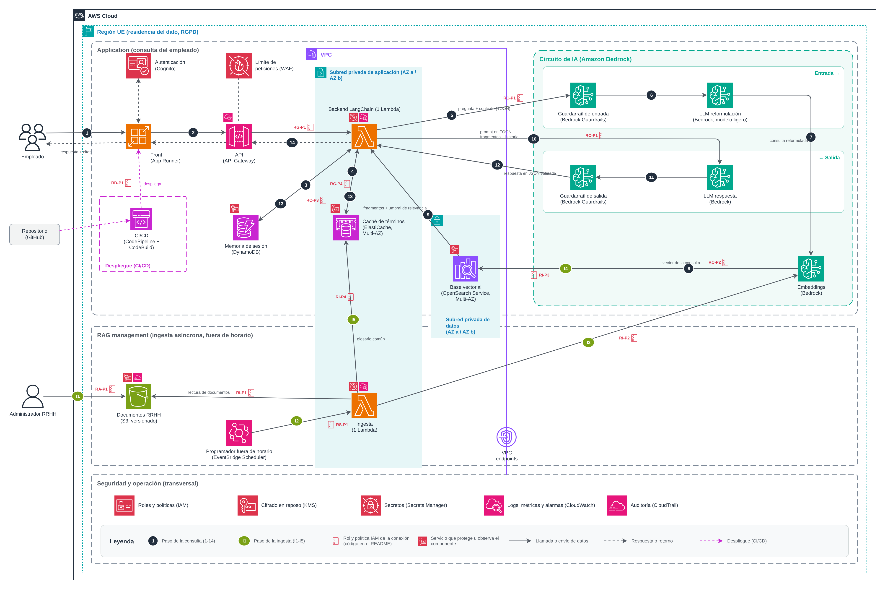
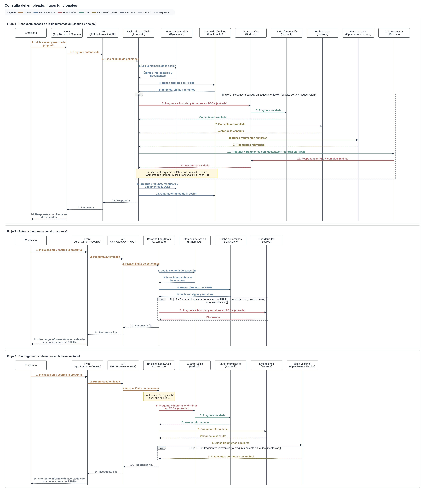
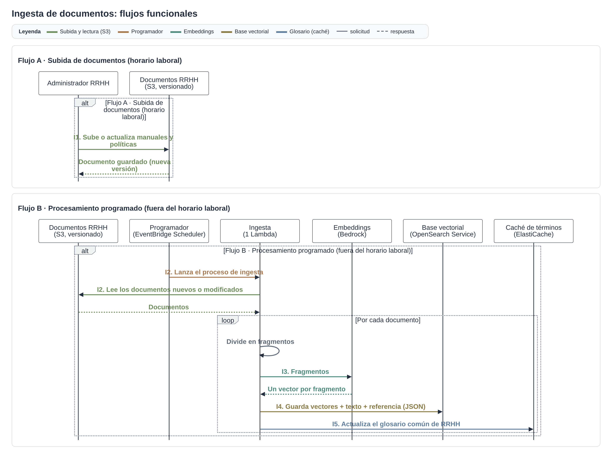

# Práctica LangChain: asistente de políticas de RRHH (AWS)

[RaulRX/AI_Architectures/Langchain](https://github.com/RaulRX/AI_Architectures/tree/main/Langchain)

**Caso:** Acme Solutions quiere que sus empleados pregunten en lenguaje natural por las políticas de RRHH (manuales, vacaciones, onboarding, código de conducta, beneficios) y obtengan respuestas precisas basadas **exclusivamente** en la documentación interna, para liberar al departamento de RRHH de las preguntas frecuentes.

## 1. Arquitectura LangChain seleccionada

**RAG (preguntas y respuestas sobre documentos) con el módulo de memoria del patrón conversacional.**

- **Por qué RAG:** el requisito central es responder solo con la documentación de RRHH. RAG recupera los fragmentos relevantes y el LLM responde únicamente a partir de ellos, citando el documento. Además desacopla conocimiento y modelo: si cambia una política, se reindexa el documento sin tocar el modelo.
- **Por qué memoria conversacional:** el empleado mantiene una conversación breve sobre la respuesta ("¿y eso aplica en periodo de prueba?"). La memoria permite reformular la pregunta con el contexto y enlazar el hilo con los documentos ya consultados.
- **Por qué no un agente con herramientas ni Plan-and-Execute:** no hay acciones que ejecutar ni tareas de varios pasos; basta una consulta al RAG por pregunta. Un agente añadiría coste, latencia e imprevisibilidad sin aportar valor, y sería más difícil garantizar que no responde fuera de la documentación.

## 2. Diagrama de arquitectura

> **Cómo leer el diagrama** · [Diagrama de arquitectura](arquitectura.png) ([arquitectura.drawio](arquitectura.drawio)), con iconos oficiales de AWS.
>
> | Símbolo | Significado |
> |---|---|
> | Círculo oscuro (1-14) | Paso de la consulta del empleado |
> | Círculo verde (I1-I5) | Paso de la ingesta de documentos |
> | Icono de permisos + código | Rol y política IAM de esa conexión (tabla de abajo) |
> | Icono pequeño sobre un componente | Servicio de seguridad u operación que lo protege u observa |
> | Línea continua / discontinua | Llamada o envío de datos / respuesta o retorno |
> | (TOON) / (JSON) en una etiqueta | Formato de lo que viaja: TOON en lo que entra al LLM, JSON en lo que sale y en lo que se guarda |

### Roles y políticas IAM

> **Importante:** lectura y escritura sobre la base vectorial van en **roles y políticas distintos**: el backend de consulta solo lee (**RC-P2**) y la ingesta solo escribe (**RI-P3**).

Cada icono de permisos del diagrama lleva uno de estos códigos:

| Código | Rol | Política |
|---|---|---|
| RG-P1 | API Gateway | Invocar la Lambda de consulta |
| RC-P1 | Backend de consulta | Invocar modelos de Bedrock y guardarraíles |
| RC-P2 | Backend de consulta | Solo lectura del índice de la base vectorial |
| RC-P3 | Backend de consulta | Leer y escribir la memoria de sesión |
| RC-P4 | Backend de consulta | Leer el glosario común y escribir los términos de la sesión |
| RI-P1 | Ingesta | Leer los documentos de S3 |
| RI-P2 | Ingesta | Invocar el modelo de embeddings |
| RI-P3 | Ingesta | Solo escritura en el índice de la base vectorial |
| RI-P4 | Ingesta | Escribir el glosario común |
| RA-P1 | Administrador de RRHH | Subir documentos al bucket (política de bucket) |
| RS-P1 | Programador | Invocar la Lambda de ingesta |
| RD-P1 | CI/CD | Desplegar el front en App Runner |

**Otros controles de seguridad** (iconos pequeños sobre cada componente):
- **KMS:** cifrado en reposo de S3, DynamoDB, ElastiCache y OpenSearch; TLS en tránsito.
- **Secrets Manager:** secretos de las Lambdas, nunca en el código.
- **CloudWatch:** logs, métricas y alarmas de Lambdas y API Gateway, sin datos personales.
- **CloudTrail:** auditoría de los cambios en los documentos de RRHH.

### Lambdas

Hay **2 Lambdas**, una por flujo. Las dos se ejecutan en la **subred privada de aplicación** y cada una tiene su propio rol IAM.

| Lambda | Flujo | Rol IAM | Para qué sirve |
|---|---|---|---|
| Backend LangChain | Consulta | Backend de consulta (RC) | Recibe la pregunta desde API Gateway y orquesta la cadena RAG con memoria: lee la memoria de sesión y la caché de términos, pasa la entrada por el guardarraíl, monta los prompts en TOON, llama al LLM de reformulación, a los embeddings y a la base vectorial, aplica el control de relevancia, llama al LLM de respuesta, valida su JSON, guarda memoria y términos y devuelve la respuesta o la respuesta fija. |
| Ingesta | Ingesta (programada) | Ingesta (RI) | La lanza EventBridge Scheduler fuera del horario laboral: lee de S3 los documentos nuevos o modificados, los divide en fragmentos, obtiene un vector por fragmento, los indexa en OpenSearch con la referencia al documento y actualiza el glosario común de la caché. |

- **Consulta en una sola Lambda:** es una cadena corta y secuencial por pregunta. Repartirla en varias Lambdas añadiría saltos de red, arranques en frío y latencia sin beneficio, porque sus pasos no escalan por separado.
- **Ingesta en una sola Lambda, sin orquestador:** el lote es pequeño (documentos de RRHH), siempre sigue los mismos pasos y no tiene ramas ni revisión humana. *Revisar si* el volumen crece hasta acercarse al límite de duración de una ejecución de Lambda (15 minutos): entonces se separaría en una Lambda que lista los documentos y otra que procesa cada uno en paralelo desde una cola.

### Flujos funcionales (secuencia)

| Consulta del empleado | Ingesta de documentos |
|---|---|
|  |  |

> **Flujos funcionales:** cada imagen separa los flujos funcionales (camino principal, entrada bloqueada, sin fragmentos relevantes; subida y procesamiento programado) y colorea las flechas por fase. Diagramas: [Secuencia de la consulta](secuencia-consulta.png) ([secuencia-consulta.mmd](secuencia-consulta.mmd)) y [Secuencia de la ingesta](secuencia-ingesta.png) ([secuencia-ingesta.mmd](secuencia-ingesta.mmd)).

### Pasos de la consulta

| Paso | Componente | Detalle |
|---|---|---|
| 1 | Front (App Runner + Cognito) | El empleado se autentica con su cuenta corporativa y escribe la pregunta. |
| 2 | API Gateway + WAF | Valida la identidad, limita las peticiones por usuario y pasa la pregunta al backend. |
| 3 | Memoria de sesión (DynamoDB) | El backend recupera los últimos intercambios y los documentos ya consultados. |
| 4 | Caché de términos (ElastiCache) | Aporta sinónimos y siglas de RRHH y los términos ya usados en la sesión. |
| 5 | Guardarraíl de entrada | Bloquea temas ajenos a RRHH, prompt injection, cambio de rol y lenguaje ofensivo. Si bloquea, respuesta fija (paso 14). |
| 6 | LLM de reformulación | Forma la consulta al RAG con la pregunta y el contexto relevante de la conversación (historial y términos, en TOON). Devuelve la consulta como texto. |
| 7 | Embeddings | Convierte la consulta en un vector (mismo modelo que en la ingesta). |
| 8 | Base vectorial (OpenSearch) | Busca los fragmentos más relevantes, priorizando los documentos ya consultados. |
| 9 | Control de relevancia | Si ningún fragmento es suficientemente relevante, respuesta fija (paso 14). |
| 10 | LLM de respuesta | Responde solo con los fragmentos (en TOON, con el documento y la sección de cada uno), con instrucciones de sistema restrictivas, y devuelve un JSON con la respuesta y los documentos citados. |
| 11 | Guardarraíl de salida | Bloquea respuestas de cambio de rol, contenido no apoyado en los documentos y datos personales. |
| 12 | Backend LangChain | Recibe la respuesta validada y comprueba el esquema del JSON y que cada cita corresponda a un fragmento recuperado. Si falla, respuesta fija (paso 14). |
| 13 | Memoria + caché de términos | Guarda pregunta, respuesta, documentos usados y términos de la sesión (en JSON). |
| 14 | Front | Devuelve la respuesta con las citas, o "No tengo información acerca de ello, soy un asistente de RRHH". |

### Pasos de la ingesta

| Paso | Componente | Detalle |
|---|---|---|
| I1 | Documentos RRHH (S3) | El administrador de RRHH sube o actualiza documentos (horario laboral). |
| I2 | EventBridge Scheduler + Lambda de ingesta | Fuera del horario laboral se procesan los documentos nuevos o modificados y se dividen en fragmentos. |
| I3 | Embeddings | Un vector por fragmento. |
| I4 | Base vectorial (OpenSearch) | Guarda vectores, texto y referencia al documento (en JSON) para poder citarlo. |
| I5 | Caché de términos | Actualiza el glosario común de RRHH. |

## 3. Descripción de componentes

| Componente | Rol en la solución | Servicio AWS | Justificación |
|---|---|---|---|
| Front | Interfaz de chat del empleado | AWS App Runner | Ejecuta la web en contenedor sin gestionar servidores, escala solo y se despliega desde el repositorio por CI/CD. |
| Autenticación | Identificar al empleado con su cuenta corporativa | Amazon Cognito | Federación con el directorio corporativo y MFA; entrega tokens que valida API Gateway. |
| API y límite de peticiones | Única entrada al backend; protección frente a avalanchas de prompts | Amazon API Gateway + AWS WAF | Autorización con Cognito, límites por usuario y reglas por tasa; separa el front del backend. |
| Backend LangChain | Orquesta la cadena RAG con memoria (memoria, guardarraíles, LLM, recuperación), monta los prompts en TOON y valida la respuesta en JSON | AWS Lambda | Cada pregunta es una petición corta y sin estado; escala por petición y no cuesta fuera del horario laboral. |
| Memoria de sesión | Últimos intercambios y documentos consultados de cada sesión | Amazon DynamoDB | Clave-valor serverless, latencia baja, caducidad automática de registros (retención corta por RGPD). |
| Caché de términos | Glosario común de RRHH + términos de la sesión | Amazon ElastiCache (Multi-AZ) | Lecturas en memoria de muy baja latencia en cada pregunta; réplica en otra AZ. |
| Guardarraíles de entrada y salida | Filtrar entradas no deseadas y respuestas fuera de rol o no apoyadas en documentos | Amazon Bedrock Guardrails | Temas denegados, filtro de palabras, detección de ataques de prompt, comprobación de grounding y datos personales, gestionados. |
| LLM de reformulación | Convertir la pregunta + contexto en una consulta autónoma | Amazon Bedrock (modelo ligero) | Tarea sencilla: un modelo ligero reduce coste y latencia. |
| LLM de respuesta | Redactar la respuesta solo con los fragmentos y citarlos | Amazon Bedrock (modelo intermedio) | Modelos gestionados sin infraestructura propia, acceso privado desde la VPC y sin uso de los datos para entrenar. |
| Embeddings | Vectorizar fragmentos y consultas con el mismo modelo | Amazon Bedrock | Mismo proveedor que los LLM; un único modelo para ingesta y consulta. |
| Base vectorial | Guardar y buscar fragmentos por similitud | Amazon OpenSearch Service (subred privada de datos, Multi-AZ) | Búsqueda vectorial y por texto; se despliega dentro de la subred privada y separa permisos de lectura y escritura por índice. |
| Documentos RRHH | Repositorio de documentos fuente | Amazon S3 | Duradero, versionado (permite volver a una política anterior) y con acceso restringido al rol de administrador. |
| Programador de ingesta | Lanzar la ingesta fuera del horario laboral | Amazon EventBridge Scheduler | Programación gestionada sin servidores. |
| Ingesta | Leer, trocear, vectorizar e indexar documentos | AWS Lambda | Proceso por lotes asíncrono, independiente de la aplicación de consulta. |
| Red privada | Aislar backend y datos de Internet | Amazon VPC (subred de aplicación y subred de datos, 2 AZ) + VPC endpoints | La base vectorial solo es accesible desde la subred de aplicación; los servicios gestionados se alcanzan sin salir a Internet. |
| CI/CD | Desplegar nuevas versiones del front | AWS CodePipeline + CodeBuild | Despliegue automático y repetible desde el repositorio. |
| Seguridad y operación | Permisos, cifrado, secretos, observabilidad y auditoría | IAM, AWS KMS, AWS Secrets Manager, Amazon CloudWatch, AWS CloudTrail | Mínimo privilegio, cifrado en reposo, sin credenciales en código, métricas y alarmas, trazabilidad de cambios. |

## 4. Decisiones clave

- **Solo documentación de RRHH:** guardarraíl de entrada, control de relevancia, instrucciones de sistema restrictivas y guardarraíl de salida. Si no hay información, respuesta fija indicando que es un asistente de RRHH.
- **TOON en lo que entra al LLM, JSON en lo que sale y en el almacenamiento:** el backend escribe en TOON el contexto de los prompts (historial y términos para la reformulación; fragmentos con sus metadatos e historial para la respuesta). Son listas de registros con los mismos campos, y TOON las expresa con menos tokens que JSON, lo que abarata cada llamada. Lo que sale del LLM y hay que validar (la respuesta con sus citas) va en JSON con esquema, y la memoria, la caché y la base vectorial guardan JSON. TOON es solo el formato del prompt: se genera al montarlo y no se almacena. La consulta reformulada es texto y no necesita formato.
- **Reformulación antes de buscar:** la consulta al RAG se forma con lo último relevante de la conversación, no con el historial completo.
- **Memoria por sesión y de corta duración**, guardando qué documentos se usaron para enlazar el hilo con ellos.
- **Caché de términos en dos niveles:** glosario común de RRHH (se actualiza en la ingesta) y términos de la sesión (caducan con ella).
- **Ingesta asíncrona**, separada de la aplicación: subida manual por un administrador y procesamiento programado fuera del horario laboral.
- **Red:** subred privada de aplicación (Lambdas y caché) y subred privada de datos solo para la base vectorial; nada expuesto a Internet salvo front y API.
- **Alta disponibilidad:** todo en al menos dos AZ (OpenSearch y ElastiCache con réplica; el resto, serverless multi-AZ).
- **CI/CD** para desplegar el front.
