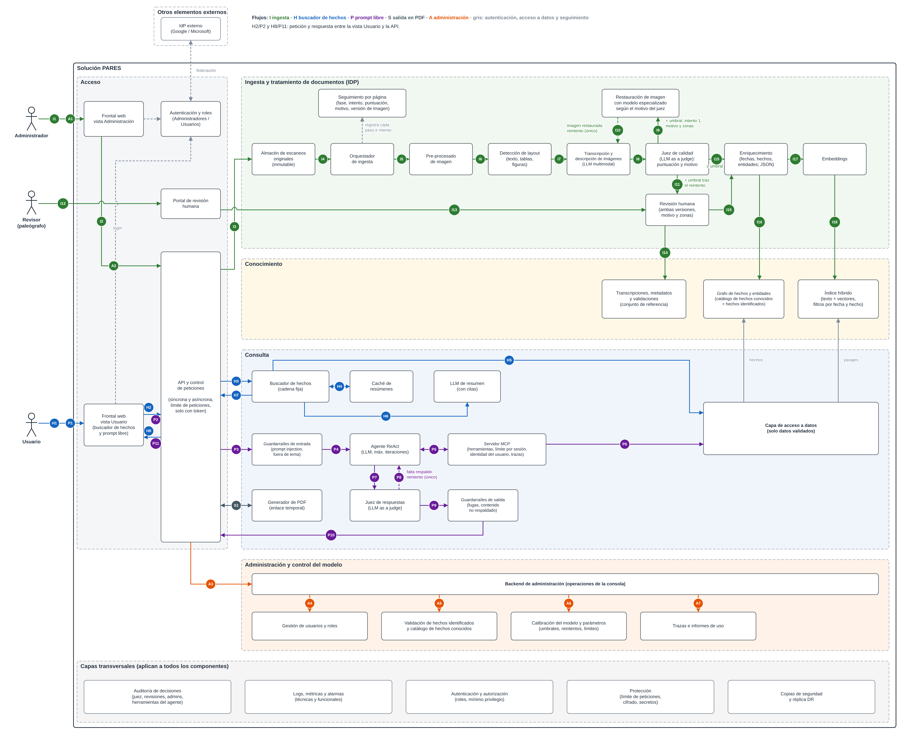
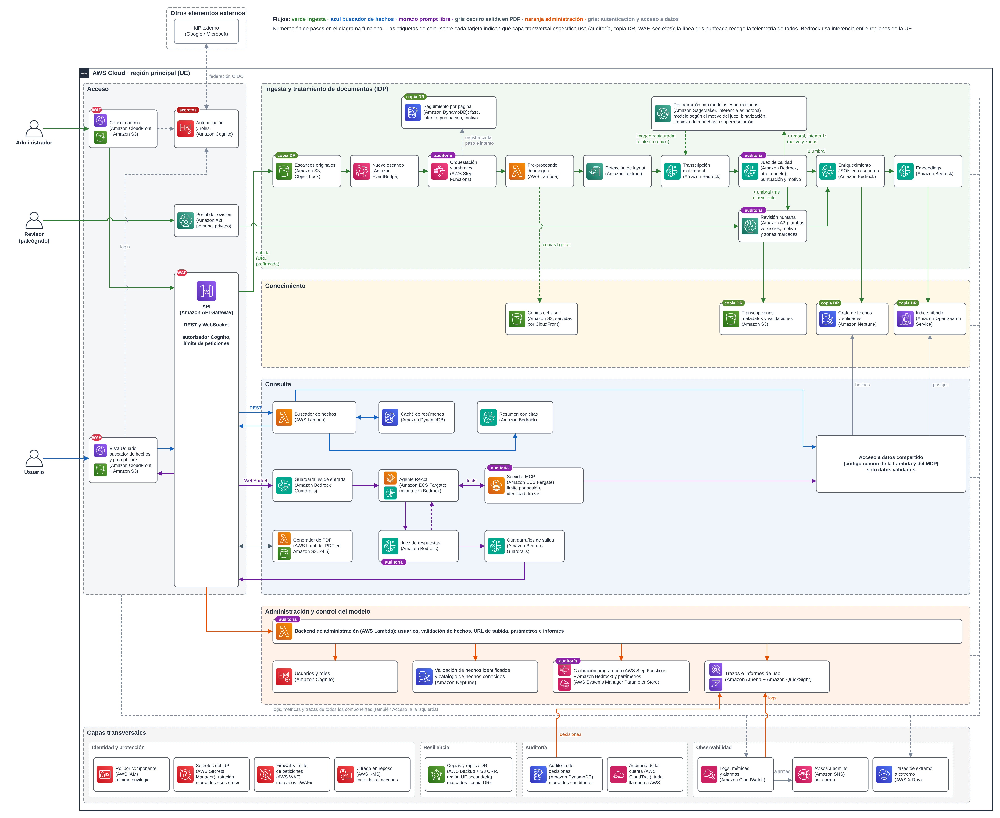

# Práctica final: consulta en lenguaje natural sobre documentos de PARES (AWS)

[RaulRX/AI_Architectures/PARES](https://github.com/RaulRX/AI_Architectures/tree/main/PARES)

**Caso:** PARES (Portal de Archivos Españoles del Ministerio de Cultura) necesita un sistema de consulta en lenguaje natural sobre documentos escaneados de 1500 a 1600, sin estructura definida y con ingestas nuevas. El sistema debe «entender» el contenido, generar metadatos por fechas vinculados a hechos conocidos o identificables, con un índice que remita a los escaneos, y ofrecer un frontal web con un explorador de hechos y una entrada en lenguaje natural. La respuesta se devuelve en texto o en PDF, el acceso es con un IdP (Google, Microsoft) y hay dos roles: Administradores y Usuarios.

## Entregable

| Documento | Enlace |
|---|---|
| **Dossier de arquitectura (Google Docs)** | [Dossier](https://docs.google.com/document/d/1hNCk5eMuDywTmmzyRGnYSisBUIVfb0Vw1xrO3xNO87c/edit?usp=drive_link) |
| Diagrama funcional | [funcional.png](funcional.png) · editable [funcional.drawio](funcional.drawio) |
| Diagrama técnico (AWS) | [tecnico.png](tecnico.png) · editable [tecnico.drawio](tecnico.drawio) |
| Pasos del diagrama funcional | [anexos/pasos-funcional.md](anexos/pasos-funcional.md) |
| Detalle de componentes y almacenamiento | [anexos/componentes.md](anexos/componentes.md) |

El dossier sigue como índice los apartados que pide el enunciado: diagrama y detalle funcional, tipología y tratamiento de datos, integración, diagrama técnico, detalle técnico, seguridad, registros y trazas, control de los modelos, monitorización, y alta disponibilidad y DR. Añade un resumen, los supuestos de partida y un apartado de elementos adicionales (coste, operación y riesgos).

## Resumen de la solución

- **Nube: AWS**, en regiones de la UE. El motivo principal es Amazon Augmented AI (A2I): los administradores deben verificar y calibrar el modelo, y A2I da revisión humana gestionada con umbrales.
- **Ingesta y tratamiento:** detección de *layout* con Amazon Textract y transcripción con un LLM multimodal de Amazon Bedrock, que también describe mapas, sellos y firmas. Un segundo LLM actúa como juez de calidad y devuelve puntuación, motivo y zonas. Si no llega al umbral, la página se restaura con modelos especializados en Amazon SageMaker y se transcribe una única vez más; si sigue sin llegar, la revisa un paleógrafo en A2I. AWS Step Functions decide con el umbral y el número de intento, y lleva el seguimiento de cada página en DynamoDB.
- **Conocimiento:** grafo de hechos y entidades en Amazon Neptune (catálogo de hechos conocidos más hechos identificados pendientes de aprobación) e índice híbrido en Amazon OpenSearch Service. Todo dato conserva la referencia al escaneo.
- **Consulta:** explorador de hechos como cadena fija con caché de resúmenes, y prompt libre con un agente ReAct en Fargate que usa herramientas a través de un servidor MCP propio, con **límite de iteraciones** y **trazabilidad de cada llamada**. Un juez de respuestas comprueba que cada dato tiene respaldo. Los usuarios solo ven datos validados: lo que falta sale como «sin datos» o «parcial».
- **Salida:** JSON que el frontal muestra como texto o que se convierte en PDF con enlace temporal.
- **Seguridad:** login federado con Google y Microsoft en Amazon Cognito, grupos Administradores y Usuarios comprobados en la API y en el MCP, cifrado con KMS, WAF, guardarraíles de Bedrock y roles IAM por componente.
- **HA/DR:** multi-AZ y copia y restauración en una segunda región de la UE; réplica continua solo de lo irrecuperable (escaneos y validaciones). RPO de 24 h para lo reconstruible y RTO de 8 h como máximo.

## Diagrama funcional

> **Cómo leer el diagrama** · Cada flujo tiene un color y una letra, y sus pasos van numerados. El detalle de cada paso está en [anexos/pasos-funcional.md](anexos/pasos-funcional.md).
>
> | Elemento | Significado |
> |---|---|
> | Verde (I) | Ingesta y tratamiento de documentos |
> | Azul (H) | Buscador de hechos |
> | Morado (P) | Prompt libre |
> | Gris oscuro (S) | Salida en PDF |
> | Naranja (A) | Administración y control del modelo |
> | Gris sin número | Autenticación, acceso a datos y seguimiento |

## Diagrama técnico

> **Cómo leer el diagrama** · Mismas zonas y colores que el funcional, sin números. Cada tarjeta lleva el icono oficial de AWS y el nombre del servicio, y los servicios de IA aparecen dentro del flujo en el que intervienen.
>
> | Elemento | Significado |
> |---|---|
> | Línea gris punteada | Logs, métricas y trazas de todos los componentes hacia CloudWatch y X-Ray |
> | Etiqueta «auditoría» | El componente registra sus decisiones en la auditoría |
> | Etiqueta «copia DR» | Almacén con copia o réplica en la región secundaria |
> | Etiqueta «WAF» | Entrada protegida por AWS WAF |
> | Etiqueta «secretos» | Usa AWS Secrets Manager |

## Decisiones principales

| Decisión | Motivo |
|---|---|
| LLM multimodal en lugar de OCR por plantilla | Los manuscritos del siglo XVI no siguen plantillas; el LLM entiende el contenido por contexto y describe las imágenes. |
| Juez de calidad con un modelo distinto del transcriptor | Un modelo que se evalúa a sí mismo tiende a ser optimista. La decisión la toma la orquestación de forma determinista. |
| Restauración condicional con modelos especializados | Solo para las páginas que el juez rechaza; el motivo elige el modelo. Necesita GPU, por eso SageMaker asíncrono y no Lambda. |
| Un reintento y después revisión humana | Reintentar más no garantiza mejora; la corrección del paleógrafo alimenta el conjunto de referencia. |
| Grafo más índice híbrido | Las consultas son relacionales (nave, capitán, tercio, batalla) y por fechas. |
| Cadena fija para el explorador, agente solo para el prompt | La entrada del explorador ya es estructurada; el agente se reserva para el lenguaje natural. |
| Límite de iteraciones y trazas de cada herramienta | Evitan bucles agénticos y permiten explicar de qué documento sale cada dato. |
| Solo datos validados | Un dato histórico mal leído presentado como cierto es peor que un hueco. |
