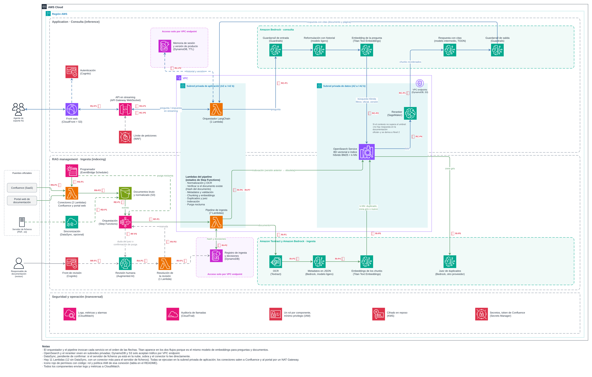
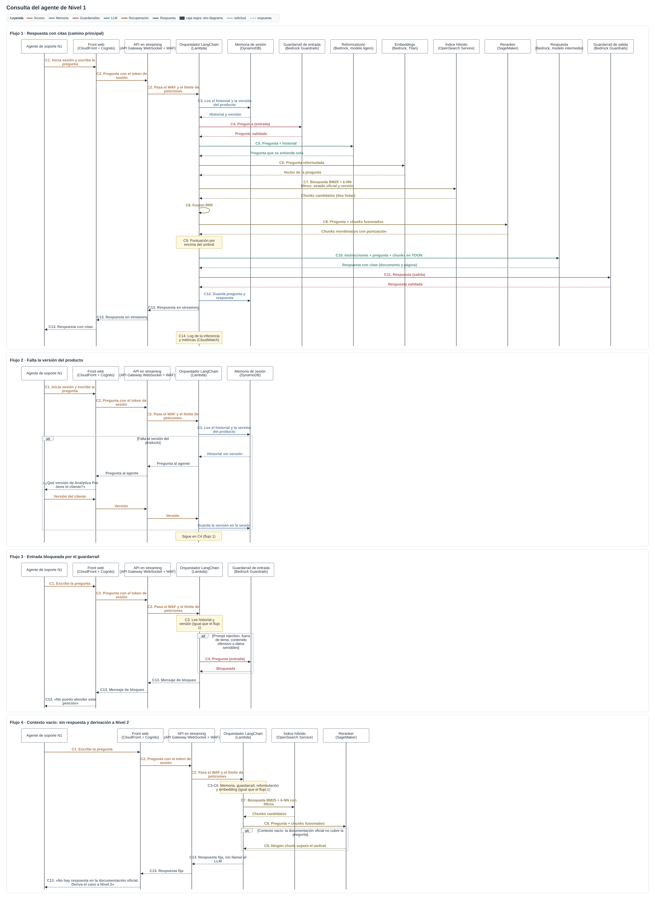
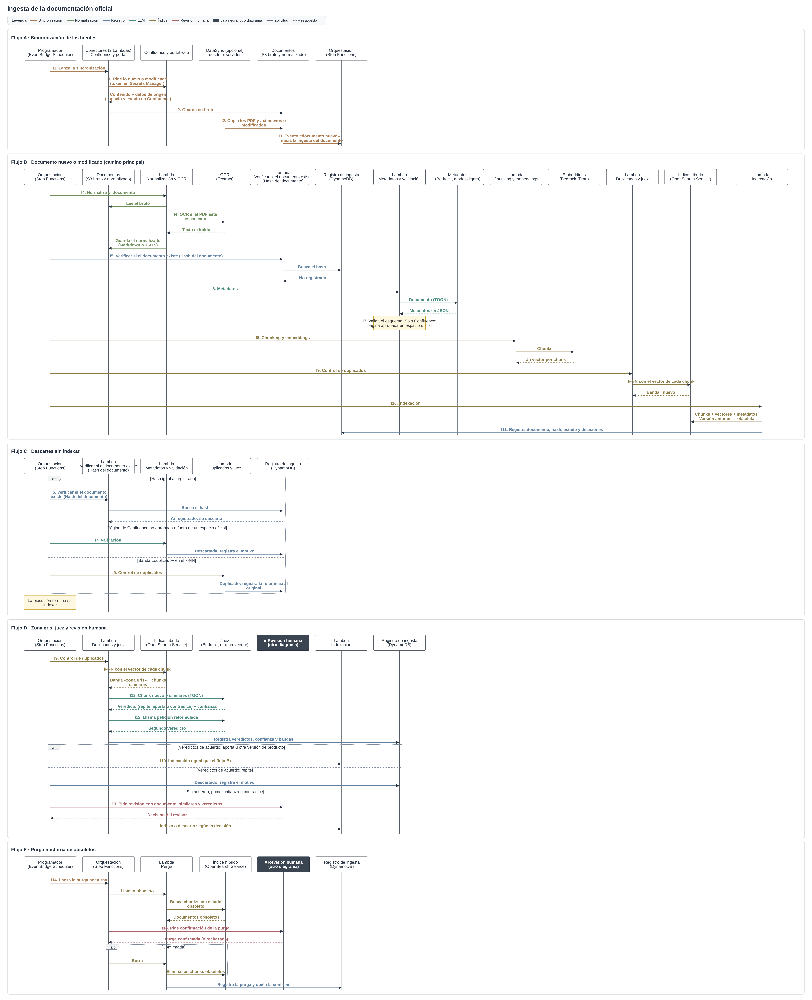
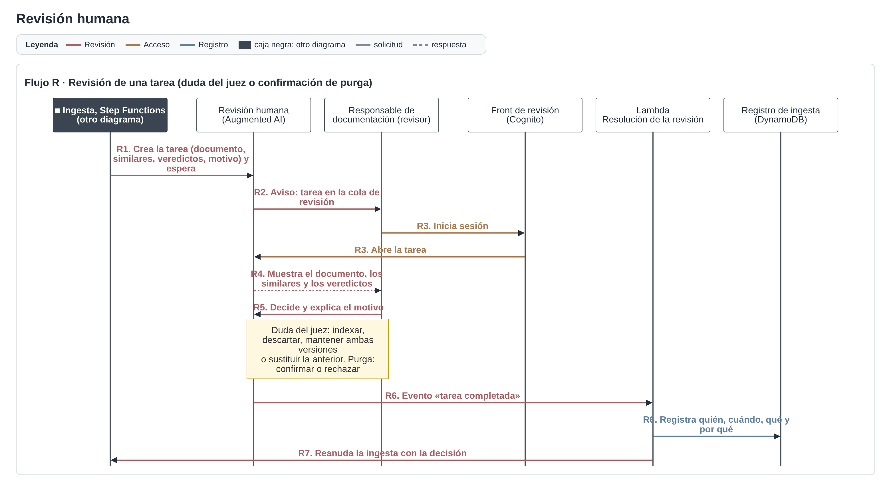

# Práctica RAG: asistente de soporte técnico de Nivel 1 (AWS)

[RaulRX/AI_Architectures/RAG](https://github.com/RaulRX/AI_Architectures/tree/main/RAG)

**Caso:** Innovatech Solutions quiere un asistente para su equipo de soporte técnico de **Nivel 1** de la suite «Analytica Pro». Los agentes preguntan en lenguaje natural y el asistente responde **exclusivamente** con la documentación oficial, repartida en tres repositorios: Confluence, el portal web de documentación y un sistema de ficheros interno (PDF y transcripciones .txt). El enunciado pide resolver tres cuestiones: la reindexación eficiente, las fuentes heterogéneas y el «contexto vacío».

## 1. Justificación de la arquitectura

### Arquitectura RAG: RAG híbrido

**BM25 + búsqueda vectorial (k-NN), fusión RRF, reranking con cross-encoder y filtros por metadatos.**

- **Por qué híbrido:** las preguntas de soporte mezclan semántica («¿cómo configuro el conector?») y términos exactos («error AP-4012», «v3.2»). La búsqueda vectorial cubre lo primero y BM25 lo segundo. RA03 presenta el RAG híbrido como la estrategia dominante y pone como ejemplo el Q&A corporativo.
- **Por qué reranking:** la fusión RRF junta dos listas de candidatos; el cross-encoder las reordena leyendo pregunta y chunk a la vez, y su puntuación sirve de umbral para detectar el contexto vacío.
- **Por qué filtros por metadatos:** solo se recupera lo oficial y vigente, y de la versión de producto del cliente.
- **Alternativas descartadas:** RAG denso (solo k-NN), que falla con códigos de error y números de versión; y RAG híbrido con *late chunking*, que queda como mejora si las preguntas que cruzan varias secciones de un manual largo dan respuestas incompletas.
- **Consecuencias:** precisión semántica y léxica en un solo servicio, a cambio de mantener dos índices y ajustar la fusión con un juego de preguntas de prueba.

### Nube: AWS

- **Contexto:** el enunciado deja elegir entre AWS y Azure y no indica la nube ni el proveedor de identidad de Innovatech. Confluence (Atlassian) no inclina la balanza. Supuesto: no hay nube previa.
- **Comparativa:** las dos nubes cubren el diseño. Ambas tienen índice híbrido (OpenSearch Service / AI Search), modelos de varios proveedores para el juez (Bedrock / AI Foundry), OCR (Textract / Document Intelligence), monitorización con alarmas (CloudWatch / Azure Monitor) y reranker gestionado o propio con fine-tuning (Bedrock Rerank o SageMaker / semantic ranker o Azure ML).
- **Por qué AWS:** la **revisión humana** es una pieza central de la ingesta (dudas del juez, conflictos y confirmación de la purga) y AWS la ofrece como servicio gestionado, **Amazon Augmented AI (A2I)**: cola de tareas, pantalla del revisor, revisores autenticados y evento al terminar, que encaja con la espera de Step Functions. En Azure no hay un servicio equivalente y habría que montarlo con Logic Apps o con una aplicación propia.
- **Costes (orientativos, precios de lista, escenario de unas 60.000 consultas y 200 revisiones al mes):** no deciden por sí solos. Con el reranker propio (T1), el índice de AWS (OpenSearch, 2 nodos, unos 220 $/mes) sale más barato que AI Search S1 con 2 réplicas (unos 490 $/mes). A2I cuesta menos de 20 $/mes. OCR, LLM, embeddings y orquestación cuestan lo mismo en ambas: dependen del modelo, no de la nube.
- **Consecuencias:** la fusión y el reranking hay que orquestarlos, con más piezas que en Azure AI Search, que los trae integrados.
- **Revisar si:** Innovatech trabaja con Microsoft 365 o Entra ID; en ese caso Azure ganaría peso.

## 2. Diagrama de arquitectura

> **Cómo leer el diagrama** · [Diagrama de arquitectura](arquitectura.png) ([arquitectura.drawio](arquitectura.drawio)), con iconos oficiales de AWS.
>
> | Elemento | Significado |
> |---|---|
> | Zona superior / inferior | Consulta (*inference*) / ingesta (*indexing*) |
> | Flecha azul / verde / gris | Flujo de consulta / flujo de ingesta / revisión humana, seguridad y registro |
> | Línea continua / discontinua | Llamada o envío de datos / camino opcional, de control o de soporte |
> | Cajas verdes de Bedrock y Textract | Servicios de IA gestionados, dibujados en el punto del flujo donde intervienen |
> | Caja rosa discontinua | Almacenes fuera de la VPC (DynamoDB) a los que solo se llega por VPC endpoint |
> | Subredes privadas | Aplicación (Lambdas) y datos (OpenSearch y reranker), sin acceso desde Internet |
> | Icono rojo de permisos + código | Rol y política IAM de esa conexión (tabla de abajo) |

### Roles y políticas IAM

> **Importante:** cada componente tiene su propio rol con mínimo privilegio, y cada Lambda del pipeline el suyo. Lectura y escritura sobre el índice híbrido van en **roles y políticas distintos**: la consulta solo lee (**RC-P2**), el control de duplicados solo lee (**RI-P5**), solo la indexación escribe (**RI-P6**) y solo la purga borra (**RI-P7**). En OpenSearch se aplican con control de acceso detallado, asociando cada rol IAM a un rol del índice.

Cada icono de permisos del diagrama lleva uno de estos códigos:

| Código | Rol | Política |
|---|---|---|
| RU-P1 | Agente de Nivel 1 (grupo de Cognito) | Usar la API de consulta |
| RG-P1 | API Gateway | Invocar la Lambda orquestador |
| RC-P1 | Orquestador (Lambda) | Invocar los modelos de Bedrock (ligero, intermedio y Titan) y los guardarraíles |
| RC-P2 | Orquestador (Lambda) | Solo lectura del índice híbrido |
| RC-P3 | Orquestador (Lambda) | Leer y escribir la memoria de sesión |
| RC-P4 | Orquestador (Lambda) | Invocar el endpoint del reranker en SageMaker |
| RC-P5 | Orquestador (Lambda) | Enviar la respuesta por la conexión WebSocket de API Gateway |
| RS-P1 | Programador (EventBridge Scheduler) | Invocar los conectores e iniciar la purga en Step Functions |
| RN-P1 | Conectores (Lambda) | Leer el token de Confluence en Secrets Manager |
| RN-P2 | Conectores (Lambda) | Escribir en S3 (bruto) |
| RD-P1 | DataSync | Escribir en S3 (bruto) |
| RE-P1 | Regla de eventos de S3 | Iniciar la ejecución de la ingesta en Step Functions |
| RF-P1 | Step Functions | Invocar las 7 Lambdas del pipeline |
| RF-P2 | Step Functions | Crear tareas de revisión en Augmented AI |
| RI-P1 | Lambda Normalización y OCR | Leer S3 (bruto), escribir S3 (normalizado) y usar Textract |
| RI-P2 | Lambda Verificar si el documento existe (Hash del documento) | Leer el registro de ingesta |
| RI-P3 | Lambda Metadatos y validación | Invocar el modelo ligero de Bedrock y escribir el registro |
| RI-P4 | Lambda Chunking y embeddings | Leer S3 (normalizado) e invocar Titan |
| RI-P5 | Lambda Duplicados y juez | Solo lectura del índice (k-NN), invocar el juez de Bedrock y escribir el registro |
| RI-P6 | Lambda Indexación | Escribir en el índice (alta y marca de obsoleto) y escribir el registro |
| RI-P7 | Lambda Purga | Leer y borrar documentos obsoletos del índice y escribir el registro |
| RA-P1 | Augmented AI | Guardar el resultado de la revisión en S3 y emitir el evento de tarea completada |
| RR-P1 | Revisor (grupo de Cognito, equipo privado de A2I) | Ver y resolver las tareas de revisión |
| RV-P1 | Lambda Resolución de la revisión | Escribir la decisión en el registro |
| RV-P2 | Lambda Resolución de la revisión | Reanudar la ejecución de Step Functions |

**Otros controles de seguridad** (franja transversal del diagrama):
- **KMS:** cifrado en reposo de S3, DynamoDB, OpenSearch y el volumen del endpoint de SageMaker; TLS en tránsito.
- **Secrets Manager:** token de Confluence y demás secretos, nunca en el código; solo los conectores pueden leer el de Confluence.
- **CloudWatch:** logs, métricas y alarmas de Lambdas, Step Functions y API Gateway, sin datos personales.
- **CloudTrail:** auditoría de las llamadas a la API de AWS, incluidos los cambios de permisos y de datos.

### Lambdas

Hay **11 Lambdas**. Si el servidor de ficheros ya estuviera en la nube y DataSync sobrara, se añadiría un conector más para leerlo (12).

| Lambda | Flujo | Para qué sirve |
|---|---|---|
| Orquestador LangChain | Consulta | Atiende la conexión WebSocket y orquesta la cadena RAG: memoria, guardarraíles, reformulación, embedding, búsqueda híbrida, fusión RRF, reranking, umbral de contexto vacío, prompt en TOON y respuesta en streaming. |
| Conector de Confluence | Ingesta | Descarga las páginas nuevas o modificadas con el estado y el espacio de cada una (token en Secrets Manager) y las deja en S3. |
| Conector del portal web | Ingesta | Descarga las páginas nuevas o modificadas del portal de documentación y las deja en S3. |
| Normalización y OCR | Ingesta (Step Functions) | Carga cada documento con el cargador de su fuente, llama a Textract si el PDF está escaneado y guarda la versión normalizada (Markdown o JSON). |
| Verificar si el documento existe (Hash del documento) | Ingesta (Step Functions) | Calcula el hash del contenido y lo compara con el registro: si ya existe, descarta el documento. |
| Metadatos y validación | Ingesta (Step Functions) | Pide los metadatos en JSON a un modelo ligero, valida el esquema y, solo para Confluence, comprueba que la página está aprobada en un espacio oficial. |
| Chunking y embeddings | Ingesta (Step Functions) | Divide el documento en chunks y obtiene un vector por chunk con Titan. |
| Duplicados y juez | Ingesta (Step Functions) | Busca chunks similares con k-NN, clasifica en duplicado, zona gris o nuevo y, en la zona gris, consulta dos veces al juez. |
| Indexación | Ingesta (Step Functions) | Indexa chunks, vectores y metadatos en OpenSearch, marca como obsoleta la versión anterior y registra la decisión. |
| Purga | Ingesta (Step Functions) | Cada noche lista los documentos obsoletos y, tras la confirmación humana, los borra del índice. |
| Resolución de la revisión | Revisión humana | Recibe la decisión del revisor desde A2I, la registra y reanuda la ingesta en Step Functions. |

Todas se ejecutan en la **subred privada de aplicación**. Los conectores salen a Confluence y al portal a través de un **NAT Gateway**, sin aceptar tráfico entrante.

### Red y seguridad

- **Red privada:** OpenSearch y el endpoint del reranker viven en subredes privadas de datos, sin acceso público. DynamoDB y S3 no viven dentro de una VPC, así que solo se accede a ellos por **VPC endpoints** y sus políticas rechazan cualquier acceso que no venga de esos endpoints.
- **Autenticación:** todo actor, persona o sistema, se autentica antes de acceder a cualquier componente (Cognito para agentes y revisores; roles IAM para los servicios).
- **Autorización:** un rol IAM por componente con mínimo privilegio. Solo personal autorizado puede publicar en el portal o subir al sistema de ficheros.
- **Guardarraíles (Bedrock Guardrails):** de entrada, contra prompt injection, intentos de saltarse las instrucciones, peticiones fuera de tema, contenido ofensivo y datos sensibles. De salida, contra fugas de datos personales o confidenciales, de las instrucciones del sistema y de contenido no respaldado por las fuentes.
- **Protección ante ataques:** WAF con límite de peticiones por usuario, cifrado en tránsito y en reposo (KMS) y secretos en Secrets Manager.
- **Registro y auditoría:** registro de ingesta y decisiones en DynamoDB, log de cada inferencia y CloudTrail para las llamadas a la API de AWS.
- **Logging, métricas y alarmas (CloudWatch):** errores de ingesta, documentos en revisión, contextos vacíos, latencia y respuestas no respaldadas por las fuentes.

## 3. Flujos funcionales (diagramas de secuencia)

Hay un diagrama por proceso. Cuando un proceso usa otro, el otro aparece como **caja negra** (participante oscuro): la ingesta llama a «Revisión humana» sin detallarla, y la revisión humana reanuda la «Ingesta» sin detallarla. Cada diagrama separa sus flujos (camino principal y alternativos) y colorea las flechas por fase.

### Consulta del agente de Nivel 1

[secuencia-consulta.png](secuencia-consulta.png) ([secuencia-consulta.mmd](secuencia-consulta.mmd))

| Paso | Componente | Detalle |
|---|---|---|
| C1 | Front web (CloudFront + Cognito) | El agente inicia sesión y escribe la pregunta. |
| C2 | API Gateway WebSocket + WAF | Valida el token, aplica el límite de peticiones y pasa la pregunta al orquestador. |
| C3 | Memoria de sesión (DynamoDB) | Historial y versión del producto. Si falta la versión, el asistente se la pregunta al agente y la guarda (flujo 2). |
| C4 | Guardarraíl de entrada | Bloquea inputs no deseados con un mensaje fijo (flujo 3). |
| C5 | Bedrock, modelo ligero | Reformula la pregunta con el historial para que se entienda sola. |
| C6 | Titan Text Embeddings | Vector de la pregunta (mismo modelo que en la ingesta). |
| C7 | OpenSearch Service | Búsqueda BM25 + k-NN filtrada por estado oficial y versión de producto. |
| C8 | Orquestador + reranker (SageMaker) | Fusión RRF y reordenación con cross-encoder. |
| C9 | Orquestador | Si ningún chunk supera el umbral: «no hay respuesta en la documentación oficial» y derivación a Nivel 2, sin llamar al LLM (flujo 4). |
| C10 | Bedrock, modelo intermedio | Responde solo con los chunks (en TOON) y cita documento y página. |
| C11 | Guardarraíl de salida | Valida la respuesta contra fugas y contenido no respaldado. |
| C12 | Memoria de sesión | Guarda pregunta y respuesta. |
| C13 | API Gateway → front | Respuesta en streaming con las citas. |
| C14 | CloudWatch | Log de la inferencia y métricas. |

### Ingesta de la documentación oficial

[secuencia-ingesta.png](secuencia-ingesta.png) ([secuencia-ingesta.mmd](secuencia-ingesta.mmd))

| Paso | Componente | Detalle |
|---|---|---|
| I1 | EventBridge Scheduler + conectores | Lanza la sincronización; los conectores piden a Confluence y al portal lo nuevo o modificado. |
| I2 | S3 (bruto) | Los conectores, y DataSync para el servidor de ficheros, dejan los documentos en bruto. |
| I3 | Evento de S3 → Step Functions | Cada documento nuevo arranca su propia ejecución de la ingesta. |
| I4 | Lambda Normalización y OCR + Textract | Formato estándar (Markdown o JSON) y OCR si hace falta. |
| I5 | Lambda Verificar si el documento existe (Hash del documento) + registro | Si el hash ya está registrado, se descarta (flujo C). |
| I6 | Lambda Metadatos + Bedrock, modelo ligero | Metadatos en JSON con el esquema único. |
| I7 | Lambda Metadatos y validación | Valida el esquema; solo Confluence: página aprobada en espacio oficial, si no se descarta (flujo C). |
| I8 | Lambda Chunking y embeddings + Titan | Un vector por chunk. |
| I9 | Lambda Duplicados y juez + OpenSearch | k-NN por chunk: duplicado (se descarta), zona gris (flujo D) o nuevo. |
| I10 | Lambda Indexación + OpenSearch | Indexa chunks, vectores y metadatos; la versión anterior pasa a obsoleta. |
| I11 | Registro (DynamoDB) | Documento, hash, estado y todas las decisiones. |
| I12 | Juez (Bedrock, otro proveedor) | En la zona gris: repite, aporta o contradice, dos veces con la petición reformulada. |
| I13 | Revisión humana (caja negra) | Si los veredictos no coinciden, la confianza es baja o hay contradicción. |
| I14 | Lambda Purga + revisión humana | Purga nocturna de obsoletos, solo con confirmación humana. |

### Revisión humana

[secuencia-revision.png](secuencia-revision.png) ([secuencia-revision.mmd](secuencia-revision.mmd))

| Paso | Componente | Detalle |
|---|---|---|
| R1 | Ingesta (caja negra) → Augmented AI | Crea la tarea con el documento, los similares, los veredictos y el motivo, y espera. |
| R2 | Augmented AI | Avisa al revisor de que hay una tarea en su cola. |
| R3 | Front de revisión (Cognito) | El revisor inicia sesión y abre la tarea. |
| R4 | Augmented AI | Muestra el documento, los similares y los veredictos. |
| R5 | Revisor | Decide y explica el motivo: indexar, descartar, mantener ambas versiones o sustituir la anterior; o confirmar o rechazar la purga. |
| R6 | Lambda Resolución de la revisión + registro | Registra quién, cuándo, qué y por qué. |
| R7 | Lambda Resolución de la revisión → ingesta | Reanuda la ejecución de Step Functions con la decisión. |

## 4. Consideraciones del enunciado

| Consideración | Cómo se resuelve |
|---|---|
| **Reindexación eficiente** | Ingesta por evento, solo de lo nuevo o modificado. Hash del contenido contra el registro para no reprocesar. Una actualización marca la versión anterior como obsoleta (excluida por filtro) y la purga nocturna la borra con confirmación humana. |
| **Fuentes heterogéneas** | Un conector y un cargador por fuente, OCR para PDF escaneados y un esquema único de metadatos validado antes de indexar. Control de duplicados entre fuentes con k-NN y juez, y una prioridad de repositorio para los conflictos. |
| **Contexto vacío** | Umbral sobre la puntuación del reranker: si nada lo supera, el asistente responde que no hay respuesta en la documentación oficial, no llama al LLM y deriva el caso a Nivel 2. El guardarraíl de salida bloquea además lo no respaldado por las fuentes. |

## 5. Descripción de componentes

| Componente | Rol en la solución | Servicio AWS | Justificación |
|---|---|---|---|
| Front web | Interfaz de chat del agente | Amazon CloudFront + S3 | Web estática servida desde la red de distribución, sin servidores. |
| Autenticación | Identificar a agentes y revisores | Amazon Cognito | Usuarios, grupos y MFA gestionados; tokens que valida API Gateway. |
| API en streaming | Única entrada al backend, con respuesta progresiva | Amazon API Gateway (WebSocket) | La respuesta llega por partes al agente mientras se genera. |
| Protección de la API | Límite de peticiones y filtrado | AWS WAF | Reglas por tasa y contra ataques web conocidos. |
| Orquestador | Cadena RAG de la consulta | AWS Lambda (LangChain) | Cada pregunta es una petición corta y sin estado; escala por petición. |
| Memoria de sesión | Historial y versión de producto por sesión | Amazon DynamoDB (con caducidad) | Clave-valor serverless de baja latencia; los datos caducan con la sesión. |
| Guardarraíles | Filtrar entradas no deseadas y fugas en la salida | Amazon Bedrock Guardrails | Detección de ataques de prompt, temas denegados, datos personales y grounding, gestionados. |
| LLM de reformulación y de metadatos | Pregunta autónoma; metadatos en JSON | Amazon Bedrock (modelo ligero) | Tareas sencillas: un modelo ligero reduce coste y latencia. |
| LLM de respuesta | Responder solo con los chunks y citar | Amazon Bedrock (modelo intermedio) | Modelos gestionados, acceso privado y sin uso de los datos para entrenar. |
| Juez de duplicados | Decidir si un chunk repite, aporta o contradice | Amazon Bedrock (modelo de otro proveedor) | Un modelo distinto al que responde reduce el sesgo de evaluarse a sí mismo. |
| Embeddings | Vectorizar preguntas y chunks | Amazon Bedrock (Titan Text Embeddings) | Mismo modelo en ingesta y consulta, dentro de Bedrock. |
| Índice híbrido | BD vectorial e índice BM25 con filtros | Amazon OpenSearch Service (subred privada) | BM25, k-NN y filtros por metadatos en un solo servicio. |
| Reranker | Reordenar los candidatos fusionados | Amazon SageMaker (cross-encoder propio) | Permite fine-tuning con la terminología de Analytica Pro, que el reranker gestionado no permite. |
| Programador | Lanzar la sincronización y la purga nocturna | Amazon EventBridge Scheduler | Programación gestionada sin servidores. |
| Conectores | Traer lo nuevo de Confluence y del portal | AWS Lambda (2) | Un conector por fuente, independientes entre sí. |
| Sincronización de ficheros | Copiar el servidor de ficheros a S3 | AWS DataSync (opcional) | Copia incremental desde un servidor local; sobra si el servidor ya está en la nube. |
| Documentos | Bruto y normalizado | Amazon S3 | Duradero y versionado; su evento arranca la ingesta. |
| Orquestación de la ingesta | Pasos, esperas y reintentos de cada documento | AWS Step Functions | Coordina las Lambdas y puede esperar a la revisión humana sin coste. |
| OCR | Texto de los PDF escaneados | Amazon Textract | OCR gestionado que conserva la estructura del documento. |
| Pipeline de ingesta | Normalizar, validar, vectorizar, deduplicar, indexar y purgar | AWS Lambda (7) | Una Lambda por paso: se prueba, escala y reintenta cada paso por separado. |
| Registro de ingesta y decisiones | Trazabilidad de qué entra y por qué | Amazon DynamoDB | BD no vectorial serverless; la verificación de si el documento existe (hash) se resuelve aquí. |
| Revisión humana | Cola de tareas y pantalla de revisión | Amazon Augmented AI (A2I) + Cognito | Flujo de revisión humana gestionado, con revisores autenticados. |
| Resolución de la revisión | Registrar la decisión y reanudar la ingesta | AWS Lambda | Une la revisión con el registro y con Step Functions. |
| Red privada | Aislar backend y datos | Amazon VPC (subredes privadas de aplicación y de datos, 2 AZ), VPC endpoints y NAT Gateway | Ningún almacén de datos visible desde fuera; salida controlada para los conectores. |
| Seguridad y operación | Permisos, cifrado, secretos, observabilidad y auditoría | IAM, AWS KMS, AWS Secrets Manager, Amazon CloudWatch, AWS CloudTrail | Mínimo privilegio, cifrado en reposo, sin credenciales en código, métricas y alarmas, trazabilidad. |

## 6. Decisiones de diseño

### Supuestos

| Id | Supuesto | Origen |
|---|---|---|
| S1 | La documentación técnica está en PDF en el sistema de ficheros interno, donde la consulta el personal de Nivel 1. | Decisión de negocio |
| S2 | Las transcripciones de vídeo (.txt) también están en el sistema de ficheros interno. | Supuesto de diseño (el enunciado no lo indica) |
| S3 | Tipo de contenido (documentación técnica, guías, transcripciones, notas de versión) y repositorio (Confluence, portal, ficheros) son dos metadatos distintos. | Lectura del enunciado |
| S4 | Los umbrales de similitud y de confianza se calibran con una muestra de documentos y preguntas. | Supuesto de diseño |
| S5 | El asistente pide al agente la versión de Analytica Pro del cliente si no la ha indicado; se guarda en la sesión y la búsqueda filtra por ella. No es la versión del documento: lo vigente u obsoleto lo resuelve la ingesta. | Decisión de Raúl |
| S6 | El contenido del portal y del sistema de ficheros es oficial por origen: si está publicado ahí, es oficial. | Decisión de Raúl |

### Ingesta

| Id | Decisión | Por qué |
|---|---|---|
| D1 | Un cargador por fuente que lo convierte todo a un formato estándar (Markdown o JSON), con OCR si el PDF está escaneado. | Fuentes heterogéneas. |
| D2 | Esquema único de metadatos (repositorio, tipo, versión de producto, fecha, estado, hash) que rellena un LLM en JSON y se valida antes de indexar. | Etiquetado coherente entre fuentes. |
| D3 | Validación de contenido oficial **solo para Confluence**: solo se indexan páginas aprobadas de espacios oficiales (control bloqueante). | Confluence es el único repositorio que mezcla borradores con lo publicado; además mitiga el riesgo de D9. |
| D4 | Ingesta por evento, solo de lo nuevo o modificado. | Reindexación eficiente. |
| D5 | Hash del contenido contra el registro (D13): si coincide, no se reprocesa. | Evita reprocesar y detecta copias exactas sin comparar contra todo el índice. |
| D6 | Duplicados en dos etapas: k-NN con tres bandas (duplicado, zona gris, nuevo) y, en la zona gris, un LLM as a Judge (repite, aporta o contradice). | Evitar duplicidades sin fusionar contenido: fusionar con un LLM crearía contenido no oficial. |
| D7 | La confianza del juez no es solo su autoevaluación: el veredicto debe repetirse con la petición reformulada o coincidir con la banda de similitud. Si no, decide una persona. | La autoevaluación de un LLM es optimista. |
| D8 | Conflictos entre fuentes: versiones de producto distintas conviven y se filtran por versión; misma versión, gana la prioridad de repositorio (D9). Una persona interviene si falta la versión o es ambigua. | En B2B conviven varias versiones en clientes distintos. |
| D9 | Prioridad de repositorio: Confluence, portal, sistema de ficheros. | Decisión de negocio: Confluence es la documentación viva y se actualiza primero; el portal se genera a partir de ella; los PDF son exportaciones estáticas. Riesgo: un borrador de Confluence podría imponerse; se mitiga con D3. |
| D10 | En una actualización, la versión anterior se marca como obsoleta y se excluye por filtro; una purga nocturna la borra solo con confirmación humana. | Lo obsoleto nunca llega al LLM y nada se borra sin control humano. |
| D13 | Registro de ingesta y decisiones en una BD no vectorial: documento (id, repositorio, versión, hash, estado, fechas) y cada decisión (veredictos y confianza, bandas, conflictos, revisiones humanas con quién, cuándo, qué y por qué, purgas). | Trazabilidad de qué entra en el conocimiento oficial y por qué. |
| D14 | Publicación restringida en el portal y en el sistema de ficheros: solo personal autorizado. | Es la condición para S6. |

### Consulta

| Id | Decisión | Por qué |
|---|---|---|
| Q1 | Contexto vacío: si nada supera el umbral, «no hay respuesta en la documentación oficial» y derivación a Nivel 2, sin inventar. | Evitar alucinaciones (consideración del enunciado). |
| Q2 | Cada respuesta cita documento y página. | Trazabilidad para el agente. |
| D11 | **TOON** en lo que entra al LLM (chunks con metadatos, entrada del juez); **JSON** en lo que sale del LLM y debe validarse, y en el almacenamiento del índice. | Ahorrar tokens sin perder la validación de la salida. |
| D12 | Memoria conversacional por sesión; la pregunta se reformula con el historial antes de buscar. | El agente mantiene el contexto del problema a lo largo de la conversación. |

### Técnicas en AWS

| Id | Decisión | Por qué |
|---|---|---|
| T1 | Reranker en SageMaker (cross-encoder propio) en lugar del reranking gestionado de Bedrock. | Fine-tuning con la terminología de Analytica Pro (decisión de Raúl). Coste: un endpoint siempre activo, mitigado con autoescalado; con unas 60.000 consultas al mes el reranker gestionado sería más barato (unos 120 $/mes), así que solo compensa en coste con mucho más volumen. |
| T2 | DataSync para llevar el sistema de ficheros a S3. **Pendiente de confirmar** que el servidor es local; si ya está en la nube, DataSync sobra y un conector lee directamente. | Supuesto: servidor de ficheros local. |
| T3 | OpenSearch y el reranker en subredes privadas; DynamoDB y S3 solo por VPC endpoint, con políticas que rechazan cualquier otro acceso. | Ningún almacén de datos visible desde fuera. |
| T4 | 11 Lambdas: 1 de consulta, 2 conectores, 7 pasos de ingesta en Step Functions y 1 de resolución de la revisión. | Cada paso de la ingesta se prueba, escala y reintenta por separado, y Step Functions puede esperar a la revisión humana. |
| T5 | Todas las Lambdas en la subred privada de aplicación; los conectores salen a Internet por un NAT Gateway. | Cumplir T3 (S3 y DynamoDB solo por endpoint) sin exponer las Lambdas. |

## 7. Pendiente y trabajo futuro

- **Pendiente:** calibrar los umbrales de similitud y de confianza (S4), decidir quién aprueba la purga (D10) y confirmar si el servidor de ficheros es local (T2).
- **Trabajo futuro, aviso por pregunta sin respuesta:** ante un contexto vacío, avisar al gestor de la documentación y registrar en la BD la pregunta (tras pasar por el guardarraíl para no guardar datos personales), la versión de producto y los documentos recuperados. Sirve para distinguir un hueco en la documentación de un fallo en la recuperación.
